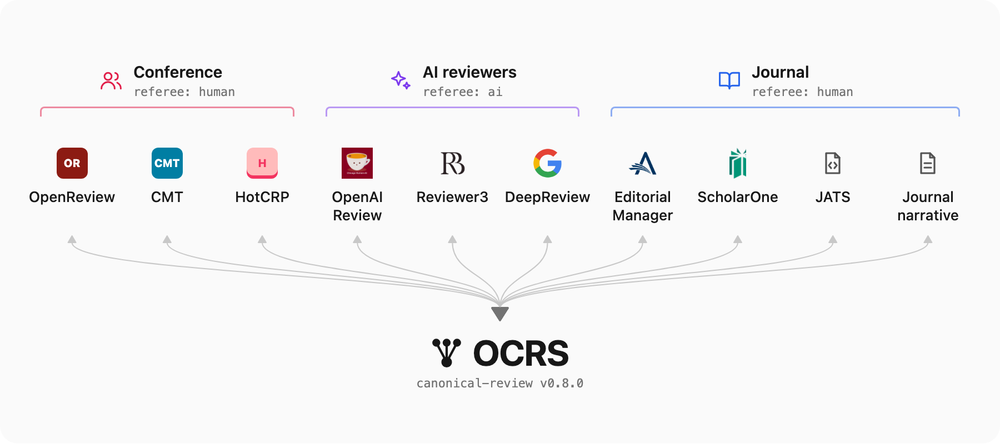

# Open Canonical Review Schema (OCRS)

[](https://github.com/valency-oss/open-canonical-review-schema/actions/workflows/ci.yml)
[](https://github.com/valency-oss/open-canonical-review-schema/actions/workflows/links.yml)
[](https://github.com/valency-oss/open-canonical-review-schema/actions/workflows/docs.yml)
[](CHANGELOG.md#080)
[](CONTRIBUTING.md#versioning)
[](https://json-schema.org/draft/2020-12)
[](pyproject.toml)
[](LICENSE)

**Status: v0.8.0, a draft. Feedback wanted:** [tell us how you use OCRS](https://github.com/valency-oss/open-canonical-review-schema/issues/new?template=adoption-story.yml) or [propose a schema change](https://github.com/valency-oss/open-canonical-review-schema/issues/new?template=schema-change.yml).

A standardized JSON schema and Python mapping utilities for peer review data. OCRS enables interoperability between different peer review systems by providing a canonical representation that preserves rich metadata including reviewer information, decision recommendations, structured findings, metrics, and AI provenance tracking.

<p align="center">
  
</p>

## Why OCRS?

Science is entering an agentic era. AI agents now draft papers, run analyses and produce other scientific output, and reviewers, human and AI working together, are writing high-quality reviews of that work faster and at larger scale than peer review ever has. A review is only useful if it can travel: to the agent that revises the paper, to the reader deciding what to trust, to the archive that keeps the record. Today review data is fragmented across conference systems, journal systems and AI reviewers, each with its own format. OCRS is a common language for reviews, so agents and people can store, exchange and show them. It does this by:

- **Giving agents one format**: An agent that writes, revises or curates science reads and writes reviews from every system the same way
- **Unifying formats**: Convert between OpenReview, CMT, HotCRP, Editorial Manager, ScholarOne, published JATS review reports, journal narratives, AI reviewers (OpenAIReview, DeepReview, Reviewer3), and more
- **Treating human, AI and hybrid reviews alike**: First-class AI/hybrid referee metadata with execution traces, model specifications, and cost tracking, so a reader can see how an AI reviewer reached its conclusions
- **Preserving provenance**: Track who reviewed, where the data came from, and how it was transformed
- **Keeping findings structured**: Findings, decisions and metrics stay machine-readable, so an agent can act on them, a site can show them, and analysts can compare reviews across platforms
- **Saying how sure**: A reviewer, human or AI, can state how likely each point is to hold and how firmly it holds that view, so a reader or an agent can tell a checked result from a hunch ([why this matters](#how-sure-the-reviewer-is-probability-and-credence))
- **Ensuring validation**: JSON Schema validation catches malformed data early

## Supported Systems

OCRS provides bidirectional mappers for converting between the canonical schema and various peer review platforms:

| System | Source (`from`) | Target (`to`) | Notes |
|--------|:---------------:|:-------------:|-------|
| **OpenReview** | Full | Full | Conference reviews with structured findings and metrics; also [a saved forum page](#reviews-from-a-saved-openreview-page) |
| **CMT** | Full | Full | Microsoft Conference Management Toolkit exports |
| **HotCRP** | Full | Full | Conference reviews; also the review object of its API |
| **Editorial Manager** | Full | Full | Journal manuscript system; also the reviewer record of its web service (`getReviewerInfoFull`) |
| **ScholarOne** | Full | Full | Clarivate journal system; also the reviewer record of its web service (`getReviewerInfoFull`) |
| **JATS** | Full | Full | Review reports published as JATS `<sub-article>`s (eLife, F1000Research, PeerJ), as [JATS4R](https://jats4r.niso.org/peer-review-materials/) recommends |
| **Journal Narrative** | Full | Full | Minimal free-text reviews with DOI/journal metadata |
| **OpenAIReview** | Full | Full | AI reviewer ([ChicagoHAI/OpenAIReview](https://github.com/ChicagoHAI/OpenAIReview)): `paper.json` |
| **DeepReview** | Full | Full | Google's AI reviewer: the Markdown that its "Copy Report" gives |
| **Reviewer3** | Full | Full | AI reviewer: the Markdown export of its report |

**Legend:**
- **Full** source: the mapper reads every field of the system's review that OCRS has a place for
- **Full** target: a review read from the system and written back to it reads back the same, its scores under their own field names and with their labels; a review from another system is written as well as the format allows

Round trips are tested both ways for every system, with each system's fixtures: written back to its own format, a review OCRS read comes back unchanged, and `tests/test_roundtrip.py` lists the system's own fields that OCRS has no place for, which a review loses on the way. `tests/test_real_reviews.py` runs the same tests on published reviews from OpenReview (ICLR, NeurIPS, COLM, TMLR), eLife, F1000Research and OpenAIReview, listed with their sources and licenses in [tests/fixtures/real/](tests/fixtures/real/README.md).

## Use the schema

The schema is at a permanent URL, one per version:

```
https://valency-oss.github.io/open-canonical-review-schema/v0.8.0/canonical-review.schema.json
```

Validate a review with any JSON Schema (draft 2020-12) validator, for example [check-jsonschema](https://github.com/python-jsonschema/check-jsonschema):

```bash
uvx check-jsonschema --schemafile https://valency-oss.github.io/open-canonical-review-schema/v0.8.0/canonical-review.schema.json review.json
```

A review names the version it follows in `$schema`, which the mappers set to the package's version. Editors such as VS Code use it to check the file as you write:

```json
{
  "$schema": "https://valency-oss.github.io/open-canonical-review-schema/v0.8.0/canonical-review.schema.json"
}
```

For complete reviews, see [examples/](examples/). The Python package below also maps reviews from other systems to OCRS.

## API
```python
from ocrs import map_from, map_to, validate_canonical

canonical = map_from("openreview", openreview_note, keep_raw=True)
validate_canonical(canonical)

note_like = map_to("openreview", canonical)
```

## Reviews from a saved OpenReview page

An OpenReview forum page lists the submission's reviews, the authors' rebuttals and the reviewers' replies. Save the page from your browser once the replies have loaded, and `scripts/openreview_page_to_ocrs.py` writes one OCRS review per Official Review:

```bash
uv run scripts/openreview_page_to_ocrs.py "Paper title | OpenReview.html" -o reviews/ --timezone America/Los_Angeles
```

The page shows dates without a time zone, so give the one you viewed it in (an IANA name, an offset written `--timezone=-07:00`, or `local`); the default is UTC. The same conversion is available in Python:

```python
from ocrs import validate_canonical
from ocrs.mappers.openreview_page import reviews_from_forum_page

reviews = reviews_from_forum_page(openreview_forum_page)  # the page's HTML
for review in reviews:
    validate_canonical(review)
```

Each review links back to the page. `provenance.source_url` opens the forum at that review, and `extensions.openreview` keeps the forum (title, authors, decision), the note as shown (heading, signature, date line) and a SHA-256 of the saved page. `extensions.openreview.source_fields` lists, for each OCRS value, the page field it came from (`findings.weaknesses[2]` from "Strengths And Weaknesses", under the heading "Minor"). Fields with no OCRS field are kept in `unmapped_fields`, and the rebuttals and replies below the review, in `replies`, each with its URL.

The review's text is copied as Markdown. Its Summary becomes `opinion.summary`; the points under its Strengths, Weaknesses and Minor headings become `findings`, with the heading in `group` and `severity: minor` for Minor; Questions become `findings.questions`; Rating, Confidence and the other numeric scores become `metrics`; Final Justification becomes `decision.summary_rationale`. A page names a score's label (`5: Accept: ...`) but not its scale, so a metric keeps the value and the label as an anchor, with no `normalized` value, and the Rating's first words (`Accept`, `Borderline reject`) set `decision.recommendation`. The saved page holds rendered mathematics, not the reviewer's TeX, so formulas are rebuilt from its MathML and may differ from what the reviewer typed.

## OpenReview notes from the API

`map_from("openreview", note)` takes a note from OpenReview's API, version 1 (`content["rating"]` is the value) or version 2 (`content["rating"]` is `{"value": …}`). A note carries the form's answers only, so two keyword arguments say what it cannot:

- `scale_bounds` gives the review form's bounds for each score field. A score is then on the form's own scale, with the form's description of each value as an anchor, and its normalized value and the recommendation it implies follow from the real bounds. Without them the scale is guessed from the value. The bounds are the form's own, so pass those of the note's form: a meta-review form can scale `confidence` differently from the official-review form.
- `submission` gives the work reviewed (`id`, `title`, `venue`, `venueid`, `doi`, `arxiv_id`), which fills `target`.

A note made by a `Meta_Review` or `Decision` invitation has `review_context.review_type` `meta_review` or `recommendation`; its `metareview` or `comment` text becomes the opinion and its `recommendation` or `decision` the decision.

A strengths, weaknesses, questions or requested-changes field written as text is read as a saved forum page's is: a list's items are its points, a heading above them (`Major concerns:`, `**Minor**`) is their `group`, and a Minor heading makes them minor. The field's text is kept as written in `narrative`, as a part titled with the field's name, and `map_to` gives it back. The note's license becomes `provenance.license`, and the note it replies to, when that is not the submission, `related_reviews`. An ethics flag (ICLR's list of choices, COLM's Yes or No) becomes `ethics_and_risk`, and the note's last change (`tmdate` or `mdate`) `updated_at`.

```python
from ocrs import map_from, validate_canonical

note = {
    "id": "r1",
    "forum": "f1",
    "invitations": ["Example.cc/2025/Conference/Submission12/-/Official_Review"],
    "content": {"summary": {"value": "A method."}, "rating": {"value": 5}},
}
canonical = map_from(
    "openreview",
    note,
    scale_bounds={"rating": {"min": 1, "max": 6, "labels": {"5": "Accept"}}},
    submission={"id": "f1", "title": "A Paper", "venue": "Example 2025"},
)
validate_canonical(canonical)
assert canonical["decision"]["recommendation"] == "accept"
```

## Reviews published in JATS

Journals that publish their reviews (eLife, F1000Research, PeerJ, Copernicus) put each report, editor's assessment and author response in the reviewed article's JATS XML, as a `<sub-article>`. `sub_articles` splits an article into one payload per report, with the article's version DOI, title and journal, which a sub-article may not repeat:

```python
from ocrs import map_from, map_to
from ocrs.mappers.jats import sub_articles

article_xml = """<article><front>
  <journal-meta><journal-title-group><journal-title>Example Journal</journal-title>
  </journal-title-group></journal-meta>
  <article-meta><article-id pub-id-type="doi" specific-use="version">10.1234/example.1.2</article-id>
  </article-meta></front>
  <sub-article article-type="referee-report" id="sa1"><front-stub>
    <article-id pub-id-type="doi">10.1234/example.1.2.sa1</article-id>
    <contrib-group><contrib contrib-type="author"><anonymous/><role>Reviewer</role></contrib>
    </contrib-group></front-stub>
    <body><p>Summary:</p><p>A sound method, <bold>well</bold> tested.</p></body>
  </sub-article></article>"""

(payload,) = sub_articles(article_xml)
review = map_from("jats", payload)
assert review["provenance"]["review_doi"] == "10.1234/example.1.2.sa1"
assert review["target"]["work_id"] == "doi:10.1234/example.1.2"
assert review["referees"][0]["identity_mode"] == "single_blind"  # <anonymous/>
assert review["opinion"]["summary"] == "A sound method, **well** tested."
assert map_to("jats", review)["sub_article"].startswith(
    '<sub-article article-type="referee-report"'
)
```

The reader takes the report's type, its DOI, the referee (name, ORCID, affiliation, or `<anonymous/>`) and competing interests, its date, the version it reviews (its `related-article`, else the article's), its license (`provenance.license`), its recommendation (F1000Research's `approve-with-reservations`, or a JATS4R term, with the term as written in `decision.source_label`), and its text, with bold and italic as Markdown and the parts under headings such as "Summary:" as narrative parts. What OCRS has no field for, such as an eLife Assessment's significance and strength terms and the authors' responses nested in a report, is kept in `extensions.jats`, and `map_to` gives it back.

## AI reviewers

The OpenAIReview, DeepReview and Reviewer3 mappers copy the reviewer's own output into OCRS; they never rewrite or invent text. Whatever has no OCRS field is kept, unchanged, in `extensions.<reviewer>`.

`map_with_record` also returns a record of how each field was mapped and where the result falls short of OCRS:

- **unmapped**: reviewer fields with no OCRS field;
- **unfilled**: OCRS fields the review leaves empty;
- **coerced**: reviewer values OCRS does not allow (for example an unknown severity), and what the mapper did instead;
- **unanchored**: quotes the reviewer took from the paper that cannot be found in it.

Each step also says how its value was taken: `copied`, `looked up` in a table, or `parsed` out of the reviewer's text by a pattern (a page number from a location, for example).

`output` is the reviewer's own file, unchanged: its JSON, or its text when the reviewer writes Markdown. The keyword arguments are what that file doesn't say: which review and paper, who produced it, the reviewer's commit or version, the model, and the run's times and cost. A hosted reviewer may publish no version or model; leave them out and the review says `unspecified`. An OpenAIReview paper.json holds one review for each model it ran, and `model_id` says which to map; without it, the first is. `work_id` can be a DOI, a URL, a canonical work ID such as `doi:10.1234/abc`, or the platform's own ID, which is kept as an `internal_id` named after `source_system`. Give the paper as plain-text `blocks` (body, abstract, references) to also check each quote against it; the record then says where each quote was found. Without `blocks`, quotes are copied but not checked.

```python
from ocrs import map_with_record, render_mapping_markdown

result = map_with_record(
    "openaireview",
    openaireview_paper_json,
    review_id="…",
    source_system="example-platform",
    work_id="…",
    work_type="preprint",
    work_version="…",
    reviewer_commit="…",
    model_id="…",
    started_at="2026-10-03T01:00:00Z",
    ended_at="2026-10-03T01:08:00Z",
    cost_usd=3.04,
)
result.review  # the OCRS review
result.record.gaps  # unmapped, unfilled, coerced (and unanchored, with blocks)
render_mapping_markdown(result)  # the same record, for people
```

DeepReview's report is Markdown. Its Strengths and Weaknesses become findings; its Weaknesses restate points made in full later, so each is marked as an overview (`summarizes`). Each point under Potential Issues And Suggestions becomes a weakness. Its part of the paper and its tier go in `group`, and the tier sets the severity: Potential Mistakes and Improvements is `major`, Minor Corrections and Typos is `minor`. The places it names become evidence links with pages and sections, the passages it quotes become evidence quotes, and the rewrites it proposes become `suggested_edits`.

```python
from ocrs import map_with_record

result = map_with_record(
    "deepreview",
    deepreview_report,
    review_id="…",
    source_system="deepreview",
    work_id="…",
    work_type="preprint",
    requested_by="authors",
    started_at="2026-10-15T17:40:00Z",
    ended_at="2026-10-15T18:05:00Z",
)
```

Reviewer3's report is Markdown too. Its Overview becomes `opinion.contributions`: what the paper contributes, as the reviewer reads it, without judgment. Its AI Text Detection, Fatal Flaws and Reference Check become `checks`, with the report's own sentence as each check's `summary`; percentages become 0–1 fractions, reference counts become integers, and each unverified reference becomes an item with its citation as printed and its status in the report's words. Only Fatal Flaws states a verdict, so it is the only check with an `outcome`. Reviewer Comments become `findings.comments`, because the report does not say whether each is a weakness, a question or a remark, so they have no severity. A comment's page and excerpt become an evidence link.

```python
from ocrs import map_with_record

result = map_with_record(
    "reviewer3",
    reviewer3_report,
    review_id="…",
    source_system="reviewer3",
    work_id="…",
    work_type="preprint",
    started_at="2026-10-15T17:00:00Z",
    ended_at="2026-10-15T17:30:00Z",
)
result.review["checks"]  # AI-text detection, fatal-flaw screen, reference check
```

### Writing a review in a reviewer's format

`map_to` writes an OCRS review back in an AI reviewer's own format: OpenAIReview's `paper.json` as a dict, DeepReview's and Reviewer3's report as Markdown text. It writes what the reviewer's mapper reads, from the same OCRS fields, and puts back what the mapper kept in `extensions.<reviewer>`, so a review mapped from a reviewer maps back to the same OCRS review. A review from anywhere else, a human one from OpenReview say, is written as well as the format allows: points the format has no place for become OpenAIReview and Reviewer3 comments, or go under headings of their own in a Markdown report; what cannot be written at all, such as scores and the decision, is left out.

```python
from ocrs import map_from, map_to

canonical = map_from("openreview", openreview_note)
paper_json = map_to("openaireview", canonical)
markdown = map_to("deepreview", canonical)  # or "reviewer3"
```

## Example

For complete human, AI and hybrid reviews, see [examples/](examples/).

A minimal canonical review in JSON:

```json
{
  "review_id": "rev_2025_001",
  "version": "1.0.0",
  "created_at": "2025-01-15T14:30:00Z",
  "provenance": {
    "source_system": "openreview",
    "source_review_id": "or_review_abc123"
  },
  "referees": [
    {
      "referee_type": "human",
      "identity_mode": "double_blind",
      "expertise": {
        "self_reported_level": "expert",
        "domain_tags": ["machine-learning", "nlp"]
      }
    }
  ],
  "target": {
    "work_id": "internal_id:openreview_forum:xyz789",
    "identifiers": {
      "internal_id": {"field_name": "openreview_forum", "value": "xyz789"}
    },
    "work_type": "preprint",
    "venue": "NeurIPS 2025"
  },
  "opinion": {
    "summary": "Solid contribution with novel approach to attention mechanisms.",
    "stance": "positive"
  },
  "decision": {
    "recommendation": "weak_accept",
    "source_label": "Weak Accept",
    "credence": 0.8
  },
  "findings": {
    "strengths": [
      {"text": "Novel architecture with strong theoretical grounding", "severity": "major"},
      {"text": "Comprehensive experiments across multiple benchmarks"}
    ],
    "weaknesses": [
      {
        "title": "No ablation for the gating module",
        "text": "Missing ablation study for key component",
        "severity": "minor",
        "evidence_links": [
          {
            "type": "paper_section",
            "ref": "Section 4.2",
            "quote": "The gating module is essential to our results."
          }
        ]
      }
    ]
  }
}
```

Converting from OpenReview format:

```python
from ocrs import map_from, validate_canonical

openreview_note = {
    "id": "or_review_1",
    "forum": "paper_123",
    "content": {
        "rating": "6: Weak Accept",
        "summary": "Interesting paper with novel contributions.",
        "review": "The main idea is promising...",
        "strengths": ["Good motivation", "Solid results"],
        "weaknesses": ["Proof incomplete"],
    },
}

canonical = map_from("openreview", openreview_note, keep_raw=True)
validate_canonical(canonical)
```

## Schema Overview

A canonical review is one JSON object. Its top-level fields are grouped below by what
they describe. Fields marked **required** must be present; everything else is optional.

**The record**

| Field | Description |
|-------|-------------|
| `$schema` | URL of the OCRS version the review follows |
| `review_id` **required** | ID of the review, unique within the system that produced it |
| `version` **required** | Version of this review record (e.g. `1.0.0`) |
| `created_at` **required**, `updated_at` | When the review was written and last changed; for AI reviews, `created_at` is when the run ended |
| `provenance` **required** | Source system (required), original IDs, the review's own DOI and license, import time, raw payload, and how the record was mapped |

**Who reviewed what**

| Field | Description |
|-------|-------------|
| `referees` **required** | Who wrote the review: one referee, or several for a panel or collaborative review. Each is human, AI, or hybrid, with identity mode (open to triple blind), expertise, competing interests, and reproducibility settings |
| `target` **required** | The version of the work being reviewed: `work_id` as `<type>:<value>` (e.g. `doi:10.1234/abc`), its identifiers, and `relations` to its other versions and forms |
| `review_context` | Kind of review, stage (pre- or post-publication), round, who requested it, and time spent |
| `related_reviews` | Other reviews this one responds to, replaces, or summarizes (a meta-review) |

**Overall judgment**

| Field | Description |
|-------|-------------|
| `opinion` **required** | Summary text, overall stance, high-level reasons, and the work's contributions |
| `decision` | Acceptance recommendation, independent revision requirement, the source's own wording of them, and how firmly the reviewer holds the recommendation (`credence`) |
| `metrics`, `metric_catalog_ref` | Scores, each on its own scale (soundness, clarity, novelty, etc.), and the catalog that defines their keys |
| `calibration` | Information for comparing this reviewer's scores with other reviewers', such as leniency and historical accept rate |

**Specific assessments**

| Field | Description |
|-------|-------------|
| `findings` | Strengths, weaknesses, questions, comments, and requested changes. Each is a point of the same shape: text, severity (info to critical), scope, evidence, suggested edits, and the findings and claims it addresses. A point can say how likely it is to hold and how sure the reviewer is of that |
| `claim_assessments` | The work's claims one by one, each with whether the evidence supports it, how likely it is true, and how sure the reviewer is of that |
| `artifact_assessments` | Availability and adequacy of the work's code, data, models, and other materials |
| `checks` | Systematic checks run on the work, such as reference verification or AI-text detection, including those that found nothing |
| `ethics_and_risk` | Ethical concerns; a change they call for is a requested change with `scope: ethics` |

**Text and documents**

| Field | Description |
|-------|-------------|
| `narrative` | The review's text as written, in parts and in order: the named text fields of a review form, the headed sections of a report, or one undivided text. A part's `role` (summary, review, questions) and `audience` (public, authors, reviewers, editors) say what it is and who may read it |
| `text_format` | How to read the review's free text: its markup and math notation |
| `written_report` | Uploaded report document (PDF, Word, Markdown, TXT) |

**Integrity and extension**

| Field | Description |
|-------|-------------|
| `signatures` | Cryptographic signatures, so readers can check who wrote the review and that it was not changed |
| `extensions` | Data with no OCRS field, kept under one key per source format (e.g. `extensions.openaireview`) |

For AI referees, the schema supports detailed provenance including model specifications, execution traces, token usage, costs, and safety metadata. Review-run seeds, for AI and human reviewers alike, go in each referee's `reproducibility.seed` and `reproducibility.seeds`. They describe the review process, not experiments in the reviewed work, and an explicit stage seed overrides the whole-review seed for that stage.

### Acceptance and revision requirements

`decision.recommendation` describes acceptance, while `decision.revision_requirement`
independently describes required revision (`none`, `minor`, `major`, or `unspecified`
when a revision is requested without stating its extent). Omission means the source
provided no revision requirement; it does not mean `none`.

```json
{
  "decision": {
    "recommendation": "weak_accept",
    "revision_requirement": "minor"
  }
}
```

### How sure the reviewer is: probability and credence

A review judges a work. OCRS also lets a reviewer judge its own judgements: how likely
each point is to hold, and how firmly it holds that view. This is metacognition, a
reviewer reporting what it knows and how well it knows it, and OCRS records it as
numbers a program can read.

It matters most for AI reviewers. A language model writes a guess in the same fluent,
assured prose as a point it has checked line by line, so its text does not show which is
which. Hedges do not help a program either: one reviewer's "may" is another's "almost
certainly". A number can be compared, and with it:

- **an agent can triage**: an agent revising the paper fixes the points the reviewer is
  sure of first, and checks the uncertain ones, or sends them to a person, before acting
  on them;
- **reviews can be combined**: points from several reviewers, human and AI, are weighed
  by how sure each reviewer is, not by how forcefully each one writes;
- **reviewers can be calibrated**: a stated probability can be scored once the outcome is
  known, when the authors confirm an error, a result replicates or a claim is retracted.
  A reviewer whose 0.9s come true nine times in ten is well calibrated; one whose 0.9s
  come true half the time is overconfident, and readers can discount it. Confidence that
  is never stated can never be checked;
- **a reviewer can say it is unsure**: a low credence keeps a tentative point in the
  review, marked as tentative, instead of forcing a choice between asserting it and
  leaving it out.

Findings and claim assessments take two numbers, each from 0 to 1:

- `probability`: how likely the reviewer thinks the point holds. For a weakness, that the
  problem is real; for a claim, that it is true.
- `credence`: how firmly the reviewer holds that probability. It is about the estimate,
  not the work: a reviewer can think a flaw likely (probability 0.9) after a quick read
  and hold that loosely (credence 0.3), or, after checking a proof with care, judge a
  claim a coin toss (probability 0.5) and be sure of exactly that (credence 0.9).
  `credence` needs `probability`.

Scores and the recommendation say how sure the reviewer is in the same way: a metric in
`uncertainty.credence`, with an optional `interval` and `rationale` (metrics within
claim assessments too), and the recommendation in `decision.credence`.

All of these are optional, and all are worth giving: a rough estimate tells a reader more
than none. Review forms ask for confidence once, for the whole review, and none of the AI
reviewers OCRS maps today gives it for each point; OCRS has a place for it so that the
reviewers that do are read the same way.

```json
{
  "findings": {
    "weaknesses": [
      {
        "title": "No ablation of the gating module",
        "text": "Table 3 reports only the full model, so the gating module's effect is untested.",
        "severity": "major",
        "probability": 0.95,
        "credence": 0.9
      },
      {
        "title": "Theorem 2 may not hold for a decaying step size",
        "text": "The proof of Theorem 2 assumes a fixed step size, but Algorithm 1 decays it.",
        "severity": "critical",
        "probability": 0.6,
        "credence": 0.3
      }
    ]
  },
  "metrics": [
    {
      "key": "overall",
      "label": "Overall",
      "scale": {"type": "ordinal", "min": 1, "max": 5},
      "value": 4,
      "uncertainty": {
        "credence": 0.6,
        "interval": {"low": 3, "high": 5},
        "rationale": "The score depends on whether Theorem 2 holds."
      }
    }
  ],
  "decision": {"recommendation": "weak_accept", "credence": 0.6}
}
```

The first weakness is one the reviewer checked: almost certainly real, and held firmly.
The second is a suspicion: critical if real, somewhat more likely than not, and held
loosely. It is the point an agent should verify before rewriting the proof, and the
reason the reviewer's score and recommendation carry less certainty.

### Linking assessments to passages

Claims, findings, metrics, and artifact assessments share `evidence_links`.
Each link retains the required `type` and free-text `ref`; its optional `location`
adds `section`, a one-based `page`, the referenced document's `version`, and a
`text_anchor`. An anchor requires `exact` text and can include the immediately
surrounding `prefix` and `suffix` to distinguish repeated sentences. Consumers
resolve the anchor against that document version; schema validation checks the
structure, not whether the passage exists.

```json
{
  "artifact_assessments": [
    {
      "artifact_type": "code",
      "availability": "public",
      "assessment": "adequate",
      "ref": "https://example.com/code",
      "evidence_links": [
        {
          "type": "paper_section",
          "ref": "Section 3.2, page 5, implementation details",
          "location": {
            "section": "3.2 Methods",
            "page": 5,
            "version": "v2",
            "text_anchor": {
              "exact": "We release the training code.",
              "prefix": "Implementation details. ",
              "suffix": " See Appendix A."
            }
          }
        }
      ]
    }
  ]
}
```

### Written Report Upload

Reviewers can optionally attach a written report document alongside their structured review. This supports traditional narrative-style reviews while maintaining the structured data benefits of OCRS.

Supported formats:
- **PDF** (`pdf`) - Portable Document Format
- **Word** (`docx`) - Microsoft Word documents
- **Markdown** (`markdown`) - Markdown text files
- **Plain Text** (`txt`) - Plain text files

Example:
```json
{
  "written_report": {
    "filename": "detailed_review.pdf",
    "content_type": "pdf",
    "url": "https://example.com/reviews/rev_001.pdf",
    "size_bytes": 245678,
    "uploaded_at": "2025-01-15T14:30:00Z",
    "content_hash": {
      "algorithm": "sha256",
      "value": "a1b2c3d4e5f6..."
    },
    "description": "Detailed technical review with annotated figures"
  }
}
```

## Entity Identifiers

OCRS provides comprehensive support for industry-standard scholarly identifiers, enabling integration with bibliographic databases and academic infrastructure.

### Work Identifiers

The `target.identifiers` field supports structured metadata for papers and other scholarly works:

| Identifier | Pattern | Resolver URL | Description |
|------------|---------|--------------|-------------|
| DOI | `10.xxxx/suffix` | `https://doi.org/{value}` | Digital Object Identifier (Crossref, DataCite) |
| arXiv ID | `YYMM.NNNNN(vN)` | `https://arxiv.org/abs/{value}` | arXiv preprint (modern/legacy formats) |
| S2CID | numeric | `https://api.semanticscholar.org/CorpusID:{value}` | Semantic Scholar Corpus ID |
| PubMed ID | numeric | `https://pubmed.ncbi.nlm.nih.gov/{value}` | PubMed/MEDLINE abstract ID |
| PMCID | `PMCnnnnnnn` | `https://pmc.ncbi.nlm.nih.gov/articles/{value}` | PubMed Central full-text ID |
| OpenAlex ID | `Wnnnnnnn` | `https://openalex.org/{value}` | OpenAlex Work ID |
| Valency ID | `W_xxxxxxxx`, `W_xxxxxxxx_vN` | `https://hub.valency.io/works/{value}` | Valency Hub work (e.g., [W_6r533gdt](https://hub.valency.io/works/W_6r533gdt)), or one version of it |
| Permalink | URI | — | Stable URL for the work |
| Internal ID | `{field_name, value}` | — | System-specific ID (HotCRP pid, ScholarOne documentId, etc.) |

**Resolution Priority**: When multiple identifiers are present, OCRS resolves in this order: DOI → arXiv → S2CID → PubMed → PMCID → OpenAlex → Valency → permalink → internal_id.

### Reviewer Identifiers

Each referee's `human_referee` object supports author/reviewer identification:

| Identifier | Pattern | Resolver URL | Description |
|------------|---------|--------------|-------------|
| ORCID | `0000-0000-0000-000X` | `https://orcid.org/{value}` | Open Researcher and Contributor ID (with checksum validation) |
| OpenAlex Author ID | `Annnnnnn` | `https://openalex.org/{value}` | OpenAlex Author ID |
| Valency Author ID | `A_xxxxxxxx` | `https://hub.valency.io/authors/{value}` | Valency Hub author (e.g., [A_7zdytxzb](https://hub.valency.io/authors/A_7zdytxzb)) |
| Scopus Author ID | 10-12 digits | — | Elsevier Scopus author identifier |
| Google Scholar ID | 12 alphanumeric | — | Google Scholar profile ID |
| Third-party ID | `{key, value}` | — | Other identifiers (Publons, ResearcherID, etc.) |

### OpenAlex Integration

[OpenAlex](https://openalex.org/) is an open catalog of the world's scholarly works. OCRS provides native support for OpenAlex entity IDs:

```python
from ocrs import build_work_identifiers, validate_openalex_work, validate_openalex_author

# Build identifiers with OpenAlex Work ID
identifiers = build_work_identifiers(
    doi="10.1234/example.2024",
    openalex_id="W2741809807",  # Automatically generates resolver URL
)
assert identifiers["openalex_id"] == {
    "value": "W2741809807",
    "hyperlink": "https://openalex.org/W2741809807",
}

# Validate OpenAlex IDs
assert validate_openalex_work("W2741809807")  # Work IDs start with 'W'
assert validate_openalex_author("A5023888391")  # Author IDs start with 'A'
```

The schema also supports OpenAlex Author IDs for reviewer identification:
```json
{
  "referees": [
    {
      "referee_type": "human",
      "identity_mode": "open",
      "human_referee": {
        "orcid": "0000-0001-5000-0007",
        "openalex_id": "A5023888391",
        "name": "Dr. Jane Smith"
      }
    }
  ]
}
```

### Valency Hub Integration

[Valency Hub](https://hub.valency.io/) publishes scholarly works. Its IDs are `W_` for a work and `A_` for an author, then at least 8 characters from a-z and 2-9 without the easily confused `i`, `l` and `o`. A work's ID with `_vN` names version N, the exact version a reviewer read:

```python
from ocrs import build_work_identifiers, validate_valency_author, validate_valency_work
from ocrs.util import migrate_work_id_to_identifiers

identifiers = build_work_identifiers(valency_id="W_6r533gdt_v1")
assert identifiers["valency_id"] == {
    "value": "W_6r533gdt_v1",
    "hyperlink": "https://hub.valency.io/works/W_6r533gdt_v1",
}

# A Hub work page or a Hub citation given as a work ID becomes a Valency ID
hub_work = {
    "valency_id": {
        "value": "W_6r533gdt",
        "hyperlink": "https://hub.valency.io/works/W_6r533gdt",
    }
}
assert migrate_work_id_to_identifiers("https://hub.valency.io/works/W_6r533gdt") == hub_work
assert migrate_work_id_to_identifiers("vlnc:W_6r533gdt") == hub_work

assert validate_valency_work("W_6r533gdt")
assert validate_valency_author("A_7zdytxzb")
```

A review of a Hub work, by a reviewer with a Hub author page:
```json
{
  "target": {
    "work_id": "valency_id:W_6r533gdt",
    "work_type": "preprint",
    "identifiers": {
      "valency_id": {
        "value": "W_6r533gdt",
        "hyperlink": "https://hub.valency.io/works/W_6r533gdt"
      }
    }
  },
  "referees": [
    {
      "referee_type": "human",
      "identity_mode": "open",
      "human_referee": {
        "valency_id": "A_7zdytxzb"
      }
    }
  ]
}
```

### ORCID Validation

ORCID identifiers are validated using the ISO 7064 MOD 11-2 checksum algorithm:

```python
from ocrs import validate_orcid, normalize_orcid

# Validate format and checksum
assert validate_orcid("0000-0001-5000-0007")  # Valid
assert not validate_orcid("0000-0001-5000-0008")  # Invalid checksum

# Normalize from various formats
assert normalize_orcid("https://orcid.org/0000-0001-5000-0007") == "0000-0001-5000-0007"
assert normalize_orcid("0000000150000007") == "0000-0001-5000-0007"
```

### Identifier Utilities

The `ocrs.identifiers` module provides utilities for working with scholarly identifiers:

```python
from ocrs import (
    build_work_identifiers,  # Construct workIdentifiers with hyperlinks
    build_resolver_url,  # Generate resolver URL for any identifier type
    resolve_primary_identifier,  # Get highest-priority identifier
    generate_canonical_work_id,  # Create "type:value" canonical ID
    validate_doi,  # Validate DOI format
    validate_arxiv,  # Validate arXiv ID format
    validate_pmcid,  # Validate PMCID format
    compute_content_hash,  # SHA-256/512 for content verification
)

# Build identifiers with automatic hyperlinks
ids = build_work_identifiers(
    doi="10.1234/example",
    arxiv_id="2401.12345",
    internal_field_name="hotcrp_pid",
    internal_value="42",
)

# Resolve to primary identifier
assert resolve_primary_identifier(ids) == ("doi", "10.1234/example")

# Generate canonical work ID
assert generate_canonical_work_id(ids) == "doi:10.1234/example"

# Build resolver URL
assert build_resolver_url("arxiv_id", "2401.12345") == "https://arxiv.org/abs/2401.12345"
```

## Related Review Platforms

OCRS currently supports these peer review systems (see [Supported Systems](#supported-systems) for implementation details):

- [OpenReview](https://openreview.net/) - Open peer review platform for scientific publishing
- [Microsoft CMT](https://cmt3.research.microsoft.com/) - Conference management toolkit
- [HotCRP](https://hotcrp.com/) - Conference review software
- [Editorial Manager](https://www.ariessys.com/software/editorial-manager/) - Journal manuscript management (Aries Systems)
- [ScholarOne](https://clarivate.com/products/scientific-and-academic-research/research-publishing-solutions/scholarone/) - Manuscript submission and peer review (Clarivate)

## Development

### Setup
You need [uv](https://docs.astral.sh/uv/getting-started/installation/). Everything else, including the git-hook runner [prek](https://github.com/j178/prek), comes with the repository: `uv sync` installs the package and its `dev` dependency group (pytest, Ruff and prek, at the versions in `uv.lock`) into `.venv`. Don't install prek or pre-commit globally.
```bash
uv sync
```

### Install the git hooks (required)
Prek is a pre-commit-compatible runner that reads `.pre-commit-config.yaml`. Install the hooks once per clone, before your first commit: besides running Ruff, the `sync-example-schema` hook sets the `$schema` of each review in `examples/` to the current schema version. Without it, a version bump leaves the examples behind and CI fails.
```bash
uv run prek install
```
The hooks then run on every `git commit`. A hook that fixes a file stops the commit: review the change, `git add` it, and commit again.

### Run hooks on all files
```bash
uv run prek run --all-files
```

### Lint and format
```bash
uv run ruff check .
uv run ruff format .
```

### Tests
```bash
uv run pytest -q
```

## Contributing

We welcome contributions! Please see [CONTRIBUTING.md](CONTRIBUTING.md) for guidelines.

## License

Apache License 2.0 - see [LICENSE](LICENSE) for details.

## Acknowledgments

The initial version of OCRS was created by [Valency Systems Inc.](https://valency.io)
